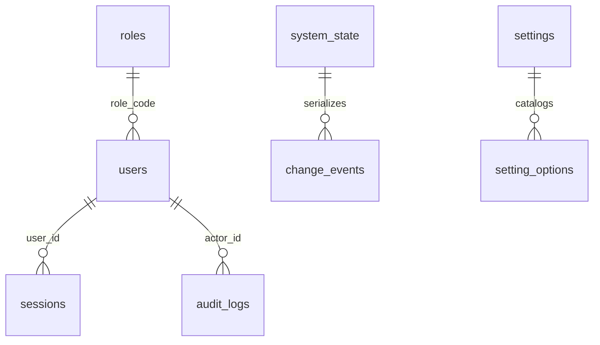
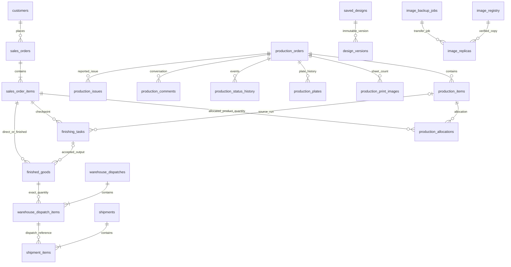

# Database schema

Target MariaDB 11.4 (local verified 11.4.9). InnoDB, utf8mb4_unicode_ci; UUID identities are ascii_bin; normalized lowercase ASCII usernames are unique case-insensitively. SQL timestamps and connection timezone are UTC, browser dates use Asia/Ho_Chi_Minh. Quantities for Phase 02 use unsigned integers when indivisible, otherwise DECIMAL(18,3); money uses DECIMAL(18,2), never FLOAT. Values larger than JS safe integers are strings at API boundaries.

## Implemented in Phase 01

| Table | Key / relationships | Purpose |
|---|---|---|
| schema_migrations | name PK; checksum/status/completed_statements | Immutable ordered schema and durable partial-DDL state |
| roles | code PK; exactly eight supported values | FK authority for users |
| users | UUID PK; username unique; role_code FK | Profile, scrypt hash, active, version, UTC timestamps, deleted_at |
| sessions | SHA-256 opaque token PK; user_id FK; user/expiry indexes | Absolute expiration, random session-bound CSRF; no plaintext auth token |
| auth_rate_limits | hashed bucket PK; expiry index | Multi-process username/IP brute-force limit |
| system_state | singleton id=1 | Permanent bootstrap completion and commit-ordered change sequence |
| settings | singleton id=1, version | Company/brand/workflow/polling scalar fields |
| setting_options | (category,position) PK; (category,value) unique | Normalized printer/paper/color/finishing catalogs |
| audit_logs | bigint PK; actor_id FK; created/id index | Administrative events; small JSON event context only, no passwords |
| change_events | bigint sequence PK; entity/sequence index | Versioned invalidation events and deletion tombstones |

001_identity.sql creates roles, identity, state, sessions and rate counters. 002_configuration_sync.sql adds settings, options, audit and change events. Migrations seed supported role codes and singleton state only. Bootstrap inserts the first Developer and initial configuration atomically; no customer/order/staff fixture is seeded.

## Planned domain relations — design, not migrated tables

A sales order splits across runs; a run can combine products from several orders. `production_allocations` links sales products to production items; unique source-item/target-item/purpose or explicit idempotency key prevents duplicate links. Standalone print runs have no allocation row. Supplemental/reprint runs reference the original product and source run, without editing completed historical runs.

Products/bags are not print sheets. `sales_order_items.quantity`, allocation product quantity and accepted finished quantity share an explicit product unit. `production_orders.total_sheets` and `production_print_images.sheet_count` measure sheets. The source's latest link history often contains zero allocatedProductQuantity and is only traceability; Phase 02 must explicitly validate numeric allocation semantics with preserved workflow rules, never infer bags from sheets.

At confirmation/assignment/completion/dispatch, lock owning parent(s) in stable UUID order, validate expected versions, calculate remaining quantity from committed allocations/goods/dispatch items, write outputs and audit in the same transaction, increment versions, then publish changes under the system-state lock. Unique idempotency keys make retries safe. Nonnegative CHECKs/FKs and composite same-parent constraints supplement backend checks. Do not hardcode broad management override for specialist printer/finisher/warehouse actions.

Every printed linked product passes the finishing checkpoint, including explicit no-work confirmation. Non-production products route directly to finishing or warehouse according to flags. Warehouse export checks every active sibling product and accepted stock for the entire sales order before creating/confirming a dispatch. Shipment returns enter stock only after inspection.

Soft delete business entities where history must remain; retain immutable status/audit history and snapshots. Increment version and emit deleted tombstones rather than dropping records. Core users currently support lock/unlock, not deletion; deleted_at is schema preparation only. No Phase 02 table or workflow is implemented in this phase.

## Migration operation

Run `npm run db:migrate` explicitly before startup. GET_LOCK scopes concurrent runners to this database. Applied migrations verify SHA-256 with LF-normalized text and rerun as no-ops. A running/failed row blocks rerun; DDL may already exist despite failure. Inspect completed_statements, information_schema and the migration before manual repair in a backed-up environment. Never edit an applied migration checksum, automatically resume unknown partial DDL, DROP or TRUNCATE a database. SQL files deliberately contain no DELIMITER, stored routines or semicolons embedded in literals.
