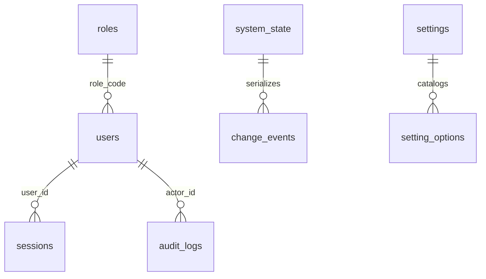
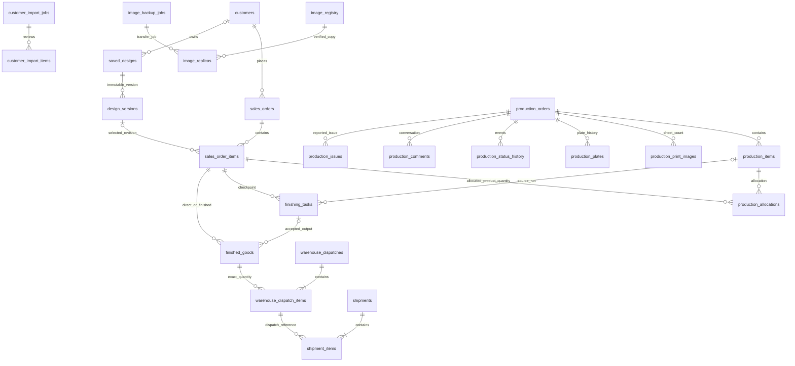

# Database schema

Target MariaDB 11.4 (local verified 11.4.9). InnoDB, utf8mb4_unicode_ci; UUID identities are ascii_bin; normalized lowercase ASCII usernames are unique case-insensitively. SQL timestamps and connection timezone are UTC, browser dates use Asia/Ho_Chi_Minh. Quantities for Phase 02 use unsigned integers when indivisible, otherwise DECIMAL(18,3); money uses DECIMAL(18,2), never FLOAT. Values larger than JS safe integers are strings at API boundaries.

## Implemented in Phase 01

| Table             | Key / relationships                                      | Purpose                                                                 |
| ----------------- | -------------------------------------------------------- | ----------------------------------------------------------------------- |
| schema_migrations | name PK; checksum/status/completed_statements            | Immutable ordered schema and durable partial-DDL state                  |
| roles             | code PK; exactly eight supported values                  | FK authority for users                                                  |
| users             | UUID PK; username unique; role_code FK                   | Profile, scrypt hash, active, version, UTC timestamps, deleted_at       |
| sessions          | SHA-256 opaque token PK; user_id FK; user/expiry indexes | Absolute expiration, random session-bound CSRF; no plaintext auth token |
| auth_rate_limits  | hashed bucket PK; expiry index                           | Multi-process username/IP brute-force limit                             |
| system_state      | singleton id=1                                           | Permanent bootstrap completion and commit-ordered change sequence       |
| settings          | singleton id=1, version                                  | Company/brand/workflow/polling scalar fields                            |
| setting_options   | (category,position) PK; (category,value) unique          | Normalized printer/paper/color/finishing catalogs                       |
| audit_logs        | bigint PK; actor_id FK; created/id index                 | Administrative events; small JSON event context only, no passwords      |
| change_events     | bigint sequence PK; entity/sequence index                | Versioned invalidation events and deletion tombstones                   |

001_identity.sql creates roles, identity, state, sessions and rate counters. 002_configuration_sync.sql adds settings, options, audit and change events. Migrations seed supported role codes and singleton state only. Bootstrap inserts the first Developer and initial configuration atomically; no customer/order/staff fixture is seeded.

## Implemented in Phase 02A

`003_sales_design.sql` extends 001/002 without changing their checksums. It uses the same InnoDB, UTC, state-lock and audit conventions.

| Table                      | Key / relationships                                                                   | Purpose                                                                                                         |
| -------------------------- | ------------------------------------------------------------------------------------- | --------------------------------------------------------------------------------------------------------------- |
| business_counters          | entity PK                                                                             | Serialized counters for KH/SO human-facing unique codes                                                         |
| customers                  | UUID PK, unique code, optional import job FK                                          | Contact, Vietnamese address hierarchy, social channels, notes, external source/ID, version and soft deletion    |
| customer_import_jobs       | UUID PK, owner FK                                                                     | Filename, source, row count, confirmed policy, lifecycle and version                                            |
| customer_import_items      | (job_id,position) PK, source record unique in job, matched and resulting customer FKs | Normalized candidate, classification, matched version and execution outcome                                     |
| sales_orders               | UUID PK, unique code, customer, sale and confirming user FKs                          | Customer and staff snapshots, priority, promise date, notes and lifecycle version                               |
| sales_order_items          | UUID PK, parent order and immutable design version FKs                                | Stable draft line identity, product requirements, separate product quantity, tombstones for removed draft lines |
| sales_order_status_history | (order_id,version) PK, order and actor FKs                                            | Explicit transitions and timestamped actor snapshot with privileged reopen reason                               |
| saved_designs              | UUID PK, creator/customer/last printer FKs                                            | Current version pointer and fields reserved for future real print activity                                      |
| design_versions            | UUID PK, design/creator/customer FKs, (design_id,version) unique                      | Immutable design metadata and customer name snapshot                                                            |
| design_version_tags        | (version_id,tag) PK                                                                   | Indexed, normalized, case/accent-insensitive tags                                                               |

Customer contact details use first-class columns. Generated active keys enforce uniqueness on normalized nonempty phone and on nonempty `(external_source,external_id)`. Soft deletion releases active keys while retaining the customer row and linked sales. Customers can share a name. Transaction-serialized codes do not change when contact details change. Name, region, date, active identity, parent/status, priority, customer and version indexes cover point lookup and common filters/orderings. Text contains search escapes LIKE wildcards and may scan within filters.

The version FK is the sales design snapshot. A new library version writes a new row with a new UUID. Order items keep their original UUID reference and still return its metadata and tags. An optional `design_versions.image_registry_id` reserves a neutral private registry reference. A 02A CHECK holds it at NULL until Phase 03 can validate the relationship and install the registry FK. Bytes, base64 and download links are absent from the image contract.

## Implemented in Phase 02B

`004_production.sql` follows 003; `005_production_link_handoff.sql` adds late-link handoff history and exactly-once design usage. Applied migrations 001–003 are unchanged.

| Table                                                               | Keys / purpose                                                                                                                                                       |
| ------------------------------------------------------------------- | -------------------------------------------------------------------------------------------------------------------------------------------------------------------- |
| production_orders                                                   | UUID PK; nullable unique LIN code assigned at dispatch; creator/printer/source-run FKs; technical fields, separate sheets, version, revision/ACK and plate state     |
| production_items                                                    | UUID PK; parent FK and `(order_id,id)` unique; product quantity; immutable design-version FK; finishing requirement                                                  |
| production_allocations                                              | UUID PK; sales/item/source-allocation/actor FKs; unique `(production_item_id,sales_item_id,kind)`; PROPOSED/ACTIVE/RELEASED; OUTPUT, zero TRACE, replacement REPRINT |
| production_tags / production_print_images                           | Normalized tags and technical labels/notes/sheet counts; registry reference CHECKed NULL until Phase 03                                                              |
| production_revisions                                                | `(order_id,revision)` PK; immutable technical snapshot, actor and reason                                                                                             |
| production_status_history / production_plates                       | Append-only events, unique order/version, actor snapshot; parallel plate state                                                                                       |
| production_issues / production_issue_users / production_issue_roles | OPEN/RESOLVED/CANCELLED reports and normalized recipient FKs; current issues nonblocking                                                                             |
| production_cancellation_requests                                    | Reasons/responder snapshots; nullable generated slot with unique `(order_id,pending_slot)` prevents concurrent pending requests                                      |
| production_comments                                                 | Text conversation and actor FK; never lifecycle authority                                                                                                            |
| production_action_receipts                                          | Unique request UUID, actor/order/action/hash and result version committed with mutation                                                                              |
| production_finishing_handoffs                                       | Same-parent composite FK to item; unique allocation FK; BAG quantity, finishing flag, replacement marker, PENDING_02C and optional superseded_at                     |
| production_design_prints                                            | Unique `(order_id,design_id)` and FKs; completed-run usage including late linking                                                                                    |

Sales products gain design-queue status/version, instruction and note fields. Queue edits cannot overwrite dispatched products. Draft links do not consume capacity; dispatch/late-link validate sums under the state lock. REPRINT is excluded from OUTPUT totals. No stock/shipment table is created. Future acceptance excludes superseded handoffs and reconciles replacement against its source. See DECISIONS and PHASE_02C_HANDOFF.

## Domain relationships, including planned downstream tables

A sales order splits across runs; a run can combine products from several orders. `production_allocations` links sales products to production items; unique source-item/target-item/purpose or explicit idempotency key prevents duplicate links. Standalone print runs have no allocation row. Supplemental/reprint runs reference the original product and source run, without editing completed historical runs.

Products/bags are not print sheets. `sales_order_items.quantity`, allocation product quantity and accepted finished quantity share an explicit product unit. `production_orders.total_sheets` and `production_print_images.sheet_count` measure sheets. The source's latest link history often contains zero allocatedProductQuantity and is only traceability; Phase 02 must explicitly validate numeric allocation semantics with preserved workflow rules, never infer bags from sheets.

At confirmation/assignment/completion/dispatch, take the system-state lock first, then lock owning parent(s) in stable UUID order. Validate expected versions, calculate remaining quantity from committed allocations/goods/dispatch items, write outputs and audit, increment versions and publish changes in the same transaction. Unique idempotency keys make retries safe. Nonnegative CHECKs/FKs and composite same-parent constraints supplement backend checks. Do not hardcode broad management override for specialist printer/finisher/warehouse actions.

Every printed linked product passes the finishing checkpoint, including explicit no-work confirmation. Non-production products route directly to finishing or warehouse according to flags. Warehouse export checks every active sibling product and accepted stock for the entire sales order before creating/confirming a dispatch. Shipment returns enter stock only after inspection.

Soft delete business entities where history must remain. Keep immutable status and audit history and snapshots. Each soft delete increments the version and emits a tombstone. Core user operations support lock and unlock, with deleted_at reserved for future use. Phase 02B production is implemented; the diagram's Phase 02C finishing/stock/dispatch/shipment tables remain planned.

## Migration operation

Run `npm run db:migrate` explicitly before startup. GET_LOCK scopes concurrent runners to this database. Applied migrations verify SHA-256 with LF-normalized text and rerun as no-ops. A running/failed row blocks rerun; DDL may already exist despite failure. Inspect completed_statements, information_schema and the migration before manual repair in a backed-up environment. Never edit an applied migration checksum, automatically resume unknown partial DDL, DROP or TRUNCATE a database. SQL files deliberately contain no DELIMITER, stored routines or semicolons embedded in literals.
